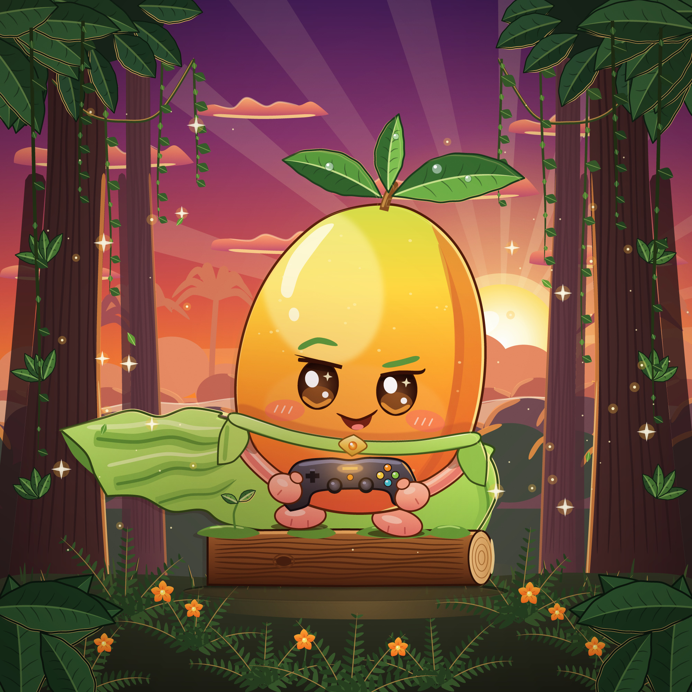
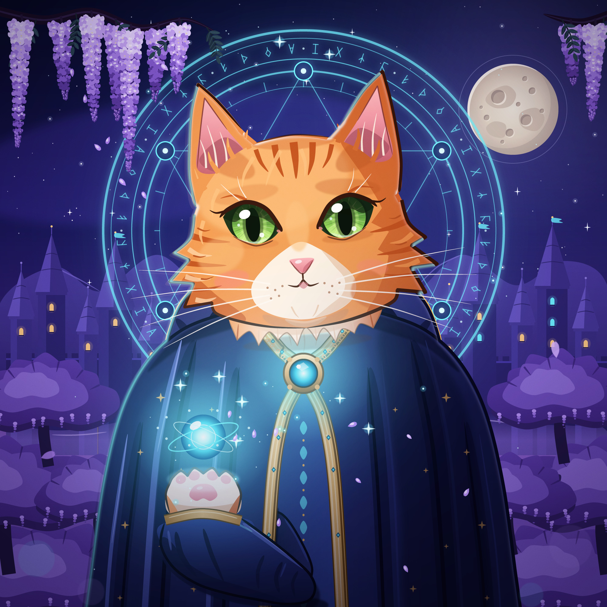

# 2D Vector Artwork Skill for Photoshop + Illustrator (`2d-vector-salik`)

A Claude Code skill that makes clean, cel-shaded 2D vector artwork (PFPs, mascots, characters with full scenes)
**inside Adobe Illustrator and Photoshop**: every shape is a hand-placed vector path written as coordinates and
built in Illustrator, then lit and finished in Photoshop on separate named layers. **No AI image generation.**

| Mango - Jungle Sunrise Gamer | Cat Mage (v7) |
|---|---|
|  |  |

These two pieces define the **house style**. The skill reproduces it from a fixed recipe
(`skill/2d-vector-salik/references/house-style.md`), a shared helper library (`scripts/vec.py`) and a starter
project (`templates/project/`, the Mango source).

## What's in this repo
```
skill/2d-vector-salik/          the installable skill
  SKILL.md                      workflow, rules, 18-point audit, toolchain, house-style quick start (section 29a)
  references/house-style.md     the exact recipe: transform, shading stack, eyes, cloth, background, palettes, Photoshop values
  scripts/                      ai_draw.py (spec -> Illustrator), vec.py (paths/tapers/gradients), qc.py, audit_sheet.py
  templates/project/            copy this to start a new piece (character, background, design, PSD generator)
  examples/mango-jungle/        full source + audit sheets + report of the Mango piece
  examples/cat-mage-v7/         full source + audit sheets + report of the cat mage
projects/mango-pfp/             the complete Mango project: ref, work files, layer PNGs, .ai, .svg, .psd, exports, QC
projects/cat-pfp/               the complete cat project history, v1 -> v7 (see the note below)
skill/2dvector-photoshop-illustrator-salik/   a second drawing skill (Photoshop + Illustrator)
skill/hand-made/                the hand-made checklist used for "Job sheet only" jobs (written for people, not agents)
studio-frontend/                the Lumora studio app (git submodule -> salikahmed595/designer-software)
.claude/launch.json             "studio-dev" preview config for the Claude desktop app
install.ps1                     installs every folder in skill/ that has a SKILL.md into ~/.claude/skills/<name>
```

## Requirements
- Windows with **Adobe Illustrator** and **Adobe Photoshop** (tested with Illustrator 28.7 and Photoshop 25.12).
- **Claude Code** (CLI or desktop app).
- The `cli-anything-illustrator` and `cli-anything-photoshop` command-line bridges on PATH (they run JSX in the open apps).
- **Python 3.10+** with **Pillow** (`pip install pillow`). Pillow is only used for resizing, contact sheets and checks, never to draw.

## Install
```powershell
git clone --recursive https://github.com/salikahmed595/2d-vectorartwork-skill-photoshop-illustrator.git
cd 2d-vectorartwork-skill-photoshop-illustrator
powershell -ExecutionPolicy Bypass -File .\install.ps1
```
`--recursive` also fetches the studio app (`studio-frontend/`). If you already cloned without it, run
`git submodule update --init`. The installer copies every skill in `skill/` into `~/.claude/skills/`; an existing
copy is moved to `~/.claude/skill-backups/<name>-<time>` first, never overwritten.
Restart Claude Code. The skill shows up as `/2d-vector-salik`.

## Studio platform (Lumora)
The studio app lets a designer pick an artwork type, write the brief and send it; a Claude Code agent then draws it
in Photoshop and Illustrator and hands back layered `.psd` / `.ai` files. Full details: `studio-frontend/README.md`.

1. Install the skills (above).
2. Install the Claude Code CLI and sign in: `irm https://claude.ai/install.ps1 | iex`, then run `claude` once.
3. Make the `photoshop` and `illustrator` MCP servers available to Claude Code (the cli-anything bridges), with the
   job folder inside their allowed folders. Check with `claude mcp list`.
4. Start the app:
   ```powershell
   cd studio-frontend
   npm install
   npm run dev
   ```
   Open http://localhost:5173. The Jobs screen says whether the agent is connected.

**Not included yet:** the app's default skill `2d-artwork-photoshop-illustrator`, and `2d-pfp` / `vtuber-master`
(they hold portfolio images). On a fresh computer, pick an installed skill as the default on the **Skills** screen,
or add those skills to `~/.claude/skills/` yourself; a job that needs a missing skill is refused with a clear message.

## Use
In Claude Code, open Illustrator and Photoshop, then:
```
/2d-vector-salik  Make a square PFP of <subject>, <pose>, holding <prop>, in a <scene> at <time of day>, <colour> theme.
```
Attach a reference image of the character if you have one. The skill:
1. writes a brief and a composition lock,
2. copies `templates/project/` and draws the character and scene as vector paths (one layer per part),
3. reviews at least three preview passes and fixes defects,
4. exports layers and builds the layered PSD with the light passes (bloom, form shade, face fill, rim, grade, vignette, grain),
5. runs QC and the 18-point audit, and delivers `.ai`, `.svg`, `.psd`, a 2000 px master, a 2000 jpg, a 1080 webp and a 512 png.

To get the same look every time, the skill follows `references/house-style.md` by default. Ask for a different style
explicitly if you want one.

## Notes on the project history (honest labels)
- `projects/cat-pfp/out/` and `work/` (**v1**) are an Image Trace of the source photo in `inbox/`, not drawn art.
- `projects/cat-pfp/v2/` was made with a local AI image generator, **before** the no-AI rule was set. It is kept
  for the record only. Every later version (v3-v7) and the Mango piece were drawn as vector paths with no AI generation
  (v4 sampled its colours and proportions from the source photo; v5 also has a non-generative Adobe adjustment-pass variant).
- `projects/cat-pfp/inbox/cat-source.png` is the reference photo that was supplied for the job.
- Two v2 log files had a local machine path replaced with `<local-path>`; nothing else was changed.

## Rules the skill enforces
- No AI image generation of any kind (no Firefly, Generative Fill/Expand, Neural Filters, text-to-image, AI upscalers).
- One layer per character part inside the character group; scene, lighting and effects on their own layers.
- Backgrounds are drawn with depth from value, colour, scale and overlap, never blurred as a shortcut.
- Nothing is reported as done, exported or checked unless it actually ran.
